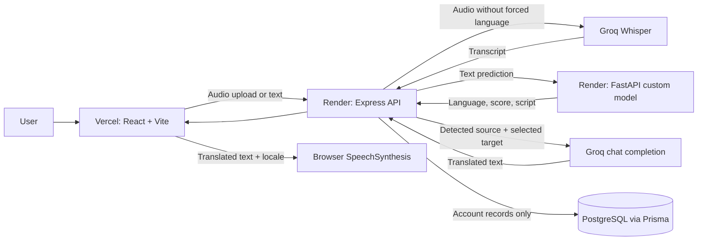

# Vaani — AI Voice Translator

Vaani is a multilingual voice and text translation app for **Hindi, English, Tamil, and Odia**. It combines Groq Whisper transcription, Vaani's custom language-identification model, Groq translation, and browser speech playback.

<p align="center">
  <a href="https://vaani-translator.vercel.app"></a>
  <a href="https://github.com/Khubaib-programmer/voice"></a>
</p>

<p align="center">
  
</p>

| React | TypeScript | Vite | Express | FastAPI | scikit-learn |
| --- | --- | --- | --- | --- | --- |
|  |  |  |  |  |  |

> **Speech recognition note:** Odia voice input can be sent to Whisper, but Odia transcription has not been independently verified. Browser text-to-speech works only when the device has a matching language voice installed.

## Contents

- [Live demo and services](#live-demo-and-services)
- [Overview and features](#overview-and-features)
- [Supported languages](#supported-languages)
- [Screenshots](#screenshots)
- [Technology stack](#technology-stack)
- [Architecture](#architecture)
- [How it works](#how-it-works)
- [Repository structure](#repository-structure)
- [Run locally](#run-locally)
- [Environment variables](#environment-variables)
- [API overview](#api-overview)
- [Custom language model](#custom-language-model)
- [Privacy and limitations](#privacy-and-limitations)
- [Future improvements](#future-improvements)
- [Contributing](#contributing)

## Live demo and services

| Service | Deployment | URL |
| --- | --- | --- |
| Web app | Vercel | [vaani-translator.vercel.app](https://vaani-translator.vercel.app) |
| Express API | Render | [voice-backend-5u7a.onrender.com](https://voice-backend-5u7a.onrender.com) |
| FastAPI language service | Render | [voice-br27.onrender.com](https://voice-br27.onrender.com) |
| Source repository | GitHub | [Khubaib-programmer/voice](https://github.com/Khubaib-programmer/voice) |

The web app and API communicate over HTTPS. The backend calls the ML service and Groq; provider credentials are kept on the backend.

## Overview and features

- Sign up and sign in with bcrypt password hashing and a signed, HttpOnly session cookie.
- Record microphone audio and transcribe it with Groq Whisper.
- Detect source language and script using Vaani's custom FastAPI model.
- Translate text on demand into a selected supported language using Groq chat completions.
- Copy translated text and play, pause, resume, or stop browser speech synthesis.
- Reject unknown or ambiguous language predictions instead of silently assuming English.
- Responsive translator workspace with recording, detection, translation, and error states.
- Translation history is disabled. Audio, transcripts, and translations are not stored in PostgreSQL; account records are stored.

## Supported languages

| Language | Code | Text detection and translation | Speech-to-text status |
| --- | --- | --- | --- |
| Hindi | `hi` | Supported | Whisper transcription implemented. |
| English | `en` | Supported | Whisper transcription implemented. |
| Tamil | `ta` | Supported | Whisper transcription implemented. |
| Odia | `or` | Supported | Experimental; not independently verified. |

## Screenshots

No current application screenshots are checked into the repository. Add real desktop and mobile captures here when available.

## Technology stack

| Area | Technologies used |
| --- | --- |
| Frontend | React 19, TypeScript, Vite 7, Tailwind CSS 3, Framer Motion, Lucide React |
| Backend | Node.js 22, Express 5, TypeScript, Zod, Multer, Helmet, CORS, express-rate-limit |
| Authentication | bcryptjs password hashing, `jose` signed JWT, HttpOnly cookies |
| Database | PostgreSQL through Prisma ORM 6 |
| Custom ML service | Python 3.12, FastAPI, scikit-learn, joblib |
| Speech-to-text | Groq Whisper API (`whisper-large-v3` by default) |
| Translation | Groq chat completions (`openai/gpt-oss-120b` by default) |
| Speech playback | Browser Web Speech API (`SpeechSynthesis`) |
| Hosting | Vercel frontend; Render Express and FastAPI services |

The speech and translation engines are third-party APIs. They were not trained from scratch by this project. Language identification uses Vaani's saved custom ML model.

## Architecture



## How it works

1. A user signs in and types a message or records speech.
2. For voice input, the browser records WebM/Opus or Ogg/Opus and uploads it to Express. Express sends the audio to Groq Whisper without a manually selected source-language hint.
3. The transcript appears in the editable message field. Express sends typed or transcribed text to the FastAPI service, which runs the custom language and script classifier.
4. On translation, Express checks the source text with the same custom model, rejects unknown/ambiguous input and same-language targets, then asks Groq to translate from the detected source to the selected target.
5. The browser displays the result and can speak the exact translated text using an installed voice matching the target locale.

The detection score is model evidence, not a calibrated probability. Transcription quality depends on the provider and audio quality; translation quality depends on the configured provider model.

## Repository structure

```text
frontend/       React app, assets, Vite configuration, and frontend tests
backend/        Express API, providers, Prisma schema/migrations, and backend tests
ml-service/     FastAPI service, custom model, data preparation, evaluation, and tests
docs/           API, architecture, dataset, ML audit, and deployment documentation
docker-compose.yml
Caddyfile
README.md
```

## Run locally

### Requirements

- Node.js 22 and npm.
- Python 3.12 and pip.
- PostgreSQL 16 or a compatible PostgreSQL database.
- A Groq API key for live transcription and translation.

### 1. Configure and start the backend

Create a database, then copy the example environment file and set its placeholders:

```bash
cd backend
cp .env.example .env
npm ci
npm run db:generate
```

Set `DATABASE_URL`, `COOKIE_SECRET` (at least 32 random characters), and `GROQ_API_KEY` in `backend/.env`. Keep populated environment files private and out of Git.

For a **new, empty database only**, initialize the schema with:

```bash
npm run db:deploy
```

Review [Database migrations](docs/deployment.md) before applying migrations to an existing database. One historical migration drops the legacy translation-history table. Start Express with:

```bash
npm run dev
```

### 2. Configure and start the ML service

From the repository root:

```bash
python3.12 -m venv ml-service/.venv312
ml-service/.venv312/bin/python -m pip install -r ml-service/requirements.txt
PYTHONPATH=ml-service/src MODEL_PATH=ml-service/artifacts/real-source-run/best_model.joblib \
  ml-service/.venv312/bin/uvicorn indic_id.api:app --host 127.0.0.1 --port 8000
```

The trained model artifact is included in the repository. Verify it with:

```bash
shasum -a 256 ml-service/artifacts/real-source-run/best_model.joblib
```

Expected SHA-256: `2a7f9b1e370d7ef3bea013c305f7e789d3fd711a619fcc3b87aa56cdd153126a`.

### 3. Configure and start the frontend

In another terminal:

```bash
cd frontend
cp .env.example .env
npm ci
npm run dev
```

Open the local URL printed by Vite (normally `http://127.0.0.1:5173`). The frontend's `VITE_API_URL` should point to the Express API, normally `http://127.0.0.1:4000` during local development.

## Environment variables

Use the checked-in example files as templates. Values below are variable names and descriptions only; never put backend credentials in frontend variables.

| Variable | Service | Purpose |
| --- | --- | --- |
| `VITE_API_URL` | Frontend | Express API base URL. |
| `NODE_ENV` | Express | Runtime mode; production enables secure cookies. |
| `PORT` | Express / FastAPI | Service listening port. |
| `HOST` | Express | Optional backend bind address. |
| `FRONTEND_ORIGIN` | Express | Exact allowed frontend origin for credentialed CORS. |
| `DATABASE_URL` | Express / Prisma | PostgreSQL connection string. |
| `COOKIE_SECRET` | Express | Session JWT signing secret; at least 32 characters. |
| `ML_SERVICE_URL` | Express | FastAPI service base URL. |
| `GROQ_API_KEY` | Express only | Server-side Groq credential. |
| `GROQ_STT_MODEL` | Express only | Speech-to-text model identifier. |
| `GROQ_TRANSLATION_MODEL` | Express only | Translation model identifier. |
| `MAX_AUDIO_BYTES` | Express | Maximum accepted recording size. |
| `MODEL_PATH` | FastAPI | Path to the saved model artifact. |
| `MIN_CONFIDENCE` | FastAPI | Optional unknown/ambiguity threshold override. |
| `MIN_MARGIN` | FastAPI | Optional prediction margin threshold override. |
| `APP_DOMAIN` | Docker Compose / Caddy | Hostname for the self-hosted HTTPS setup. |
| `POSTGRES_PASSWORD` | Docker Compose | Password for the Compose-managed PostgreSQL instance. |

See [frontend/.env.example](frontend/.env.example), [backend/.env.example](backend/.env.example), [ml-service/.env.example](ml-service/.env.example), and the root [.env.example](.env.example). The Groq key must never use a `VITE_` prefix.

## API overview

Translator routes require an authenticated session cookie. Express mounts authentication under `/api/auth` and translator routes under `/api`.

| Method | Path | Description |
| --- | --- | --- |
| `POST` | `/api/auth/signup` | Create an account and set a session cookie. |
| `POST` | `/api/auth/login` | Authenticate and set a session cookie. |
| `POST` | `/api/auth/logout` | Clear the session cookie. |
| `GET` | `/api/auth/me` | Return the current account. |
| `POST` | `/api/detect` | Detect source language from `{ "text": "..." }`. |
| `POST` | `/api/transcribe` | Accept multipart `audio`; return transcript and language detection. |
| `POST` | `/api/translate` | Translate `{ "text": "...", "targetLanguage": "hi|en|ta|or" }`. |
| `GET` | `/health` | Express process health response. |

The FastAPI service exposes `GET /health` and `POST /predict` for model readiness and prediction. See [the API documentation](docs/api.md) for request and response details. TTS is handled in the browser; there is no backend TTS endpoint.

## Custom language model

The custom detector uses character n-gram TF-IDF features (2–5 grams) with scikit-learn classifiers. Logistic Regression and Linear SVM were compared; the saved production pipeline uses Linear SVM with confidence/margin rejection for unknown or ambiguous inputs. FastAPI loads the artifact once at service startup.

The documented grouped test evaluation reports **96.9% accuracy** and **0.9676 macro F1**. These are dataset evaluation results, not guarantees for production inputs, speech recognition, translation, or cross-dataset generalization. The prepared dataset has 5,000 real rows; verified Odia code-mixed training data is unavailable. See [dataset documentation](docs/datasets.md), [ML audit](docs/ml-audit.md), and [experiment results](docs/ml-experiments.md).

## Privacy and limitations

- Translation history is disabled. PostgreSQL stores account records, not audio, transcripts, or translated text.
- Audio is held in backend memory while sent to Groq for transcription. Groq processes the text/audio needed for its inference calls.
- Odia transcription has not been independently verified.
- Browser speech synthesis requires a matching voice on the user's device. Vaani does not silently substitute an English voice for an Indic language.
- Speech and translation depend on Groq account access, quotas, and service availability.
- Render services may have startup delays. No keep-alive polling is used.

## Future improvements

- Add current desktop and mobile screenshots after capturing the deployed interface.
- Expand independently sourced evaluation data, especially verified Odia code-mixed text.
- Measure end-to-end latency and provider behavior across supported languages.

## Contributing

Keep changes within the four-language scope and preserve the custom ML detection path and no-translation-history policy. Add focused tests for behavior changes. Before opening a pull request, run:

```bash
cd frontend && npm test && npm run build
cd ../backend && npm test && npm run build
cd ../ml-service && PYTHONPATH=src .venv312/bin/python -m pytest -q
```

For dataset changes, retain source attribution and license information in the dataset manifest. Do not commit populated `.env` files, secrets, raw datasets, or user audio.
