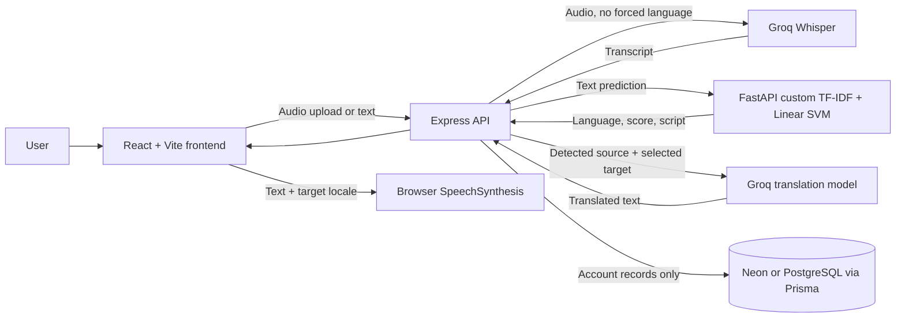

# Vaani — AI Voice Translator

Vaani is an academic multilingual voice and text translator for **Hindi, English, Tamil, and Odia**. It combines speech transcription, a custom language-identification model, provider-backed translation, and browser speech playback.

<p align="center">
  
</p>

> **Voice recognition note:** Odia recording can be submitted to Whisper, but Odia speech recognition has not been independently verified. Browser speech playback also depends on whether the device has a matching voice installed.

## Contents

- [Live demo](#live-demo)
- [Features](#features)
- [Supported languages](#supported-languages)
- [Screenshots](#screenshots)
- [Architecture](#architecture)
- [Technology](#technology)
- [Repository layout](#repository-layout)
- [How it works](#how-it-works)
- [Local setup](#local-setup)
- [Environment variables](#environment-variables)
- [Database and migrations](#database-and-migrations)
- [API endpoints](#api-endpoints)
- [Language model](#language-model)
- [Deployment](#deployment)
- [Known limitations](#known-limitations)
- [Future work](#future-work)
- [Contributing](#contributing)
- [License](#license)

## Live demo

No public demo URL is currently verified in this repository. The application can be run locally by following the setup instructions below.

## Features

- Account signup and login with password hashing and an HttpOnly session cookie.
- Microphone recording in supported browser audio formats.
- Groq Whisper speech-to-text without a forced source-language hint.
- Automatic source-language and script identification by Vaani's custom FastAPI model.
- Hindi, English, Tamil, and Odia text translation through Groq chat completions.
- Copy translated text and play, pause, resume, or stop browser speech synthesis when the requested language voice is available.
- Responsive React interface with recording, detection, translation, and error states.
- Translation history is disabled. Audio, transcripts, and translations are not written to PostgreSQL; the database stores user accounts.

## Supported languages

| Language | Code | Text detection and translation | Speech transcription |
| --- | --- | --- | --- |
| Hindi | `hi` | Supported | Whisper transcription is implemented; end-to-end quality depends on the provider and audio. |
| English | `en` | Supported | Whisper transcription is implemented. |
| Tamil | `ta` | Supported | Whisper transcription is implemented. |
| Odia | `or` | Supported for text | Experimental; not independently verified. |

## Screenshots

No application screenshots are currently checked into the repository. Add real captures under `docs/screenshots/` and reference their relative paths here when available.

## Architecture



## Technology

| Layer | Implementation |
| --- | --- |
| Frontend | React 19, TypeScript, Vite, Tailwind CSS, Framer Motion |
| API | Node.js 22, Express 5, TypeScript |
| Language identification | Python, FastAPI, scikit-learn, character TF-IDF, Linear SVM |
| Speech-to-text | Groq Whisper API |
| Translation | Groq chat completions |
| Speech playback | Browser Web Speech API (`SpeechSynthesis`) |
| Database | PostgreSQL, Prisma ORM |
| Production target | Vercel frontend, Render API and ML service, Neon PostgreSQL |

## Repository layout

```text
frontend/       React application, public branding, tests, Vite configuration
backend/        Express API, Prisma schema/migrations, provider integration, tests
ml-service/     FastAPI application, language model, evaluation code and tests
docs/           API, architecture, dataset, ML audit, integration and deployment docs
docker-compose.yml
Caddyfile
README.md
```

## How it works

1. A user signs in, then types text or records a message.
2. For audio, the browser records WebM/Opus or Ogg/Opus and uploads it to Express. Express sends it to Groq Whisper without supplying a language hint. The transcript is returned to the editable message field.
3. Express sends typed or transcribed text to the custom FastAPI classifier. The classifier returns a language decision, model score evidence, and script evidence. Its score is not a calibrated probability.
4. When the user translates, Express independently checks the source text with the same custom model, rejects unknown/ambiguous or same-language requests, and sends the detected source and selected target to Groq.
5. The frontend keeps the translated result in page state. Browser speech synthesis reads the exact translated text if an appropriate target-language voice is available.

Groq credentials are used only by the backend. Groq provides the speech and translation engines; those models were not trained by this project. The custom language-identification model is Vaani's own saved classifier.

## Local setup

### Requirements

- Node.js 22 and npm.
- Python 3.12 and pip.
- PostgreSQL 16 or a compatible PostgreSQL connection.
- A Groq API key for live transcription and translation requests.

### 1. Configure the database and backend

Create a PostgreSQL database, then copy `backend/.env.example` to `backend/.env`. Set `DATABASE_URL`, a random `COOKIE_SECRET` of at least 32 characters, and `GROQ_API_KEY`. Keep this file private and out of Git.

```bash
cd backend
npm ci
npm run db:generate
```

For a **new, empty database only**, the migration command is:

```bash
npm run db:deploy
```

Review [Database and migrations](#database-and-migrations) before applying it to any existing database. Start the API locally with:

```bash
npm run dev
```

### 2. Start the ML service

From the repository root:

```bash
python3.12 -m venv ml-service/.venv312
ml-service/.venv312/bin/python -m pip install -r ml-service/requirements.txt
PYTHONPATH=ml-service/src MODEL_PATH=ml-service/artifacts/real-source-run/best_model.joblib \
  ml-service/.venv312/bin/uvicorn indic_id.api:app --host 127.0.0.1 --port 8000
```

The saved model is included in the repository. Verify the artifact with:

```bash
shasum -a 256 ml-service/artifacts/real-source-run/best_model.joblib
```

Expected SHA-256: `2a7f9b1e370d7ef3bea013c305f7e789d3fd711a619fcc3b87aa56cdd153126a`.

### 3. Start the frontend

In a separate terminal:

```bash
cd frontend
npm ci
npm run dev
```

Open the URL printed by Vite (normally `http://localhost:5173`). Set `VITE_API_URL` in `frontend/.env` if the API is not at the local default `http://127.0.0.1:4000`.

## Environment variables

Names below are taken from the repository's example files and service configuration. Set secrets in the service environment; do not put backend credentials in Vite variables.

| Variable | Used by | Purpose |
| --- | --- | --- |
| `VITE_API_URL` | Frontend | Express API base URL; local default is `http://127.0.0.1:4000`. |
| `NODE_ENV` | Backend | Runtime mode; use `production` for secure production cookies. |
| `PORT` | Backend / ML service | HTTP listening port. |
| `HOST` | Backend | Optional Express bind address. |
| `FRONTEND_ORIGIN` | Backend | Exact allowed frontend origin for credentialed CORS. |
| `DATABASE_URL` | Backend | PostgreSQL connection string used by Prisma. |
| `COOKIE_SECRET` | Backend | Signing key for session JWTs; provide at least 32 random characters. |
| `ML_SERVICE_URL` | Backend | Base URL for the FastAPI service. |
| `GROQ_API_KEY` | Backend | Server-side credential for Groq requests. |
| `GROQ_STT_MODEL` | Backend | Groq speech-to-text model identifier. |
| `GROQ_TRANSLATION_MODEL` | Backend | Groq translation model identifier. |
| `MAX_AUDIO_BYTES` | Backend | Maximum audio upload size in bytes. |
| `MODEL_PATH` | ML service | Path to the saved joblib model bundle. |
| `MIN_CONFIDENCE` | ML service | Optional model acceptance threshold override. |
| `MIN_MARGIN` | ML service | Optional ambiguity margin threshold override. |
| `APP_DOMAIN` | Docker Compose / Caddy | Public hostname used for the HTTPS edge. |
| `POSTGRES_PASSWORD` | Docker Compose | Password for the Compose-managed PostgreSQL database. |

See [`backend/.env.example`](backend/.env.example), [`frontend/.env.example`](frontend/.env.example), and [`.env.example`](.env.example) for placeholders and local values. Never commit populated `.env` files. The Groq key must not be named or exposed as a `VITE_*` variable.

## Database and migrations

Prisma's current schema contains only the `User` model. The initial migration also creates a legacy `TranslationHistory` table, and the later `20261111000000_remove_translation_history` migration drops it. That removal migration is destructive to any legacy translation rows. It is not run automatically when the server starts.

Before running migrations against an existing database, take a verified backup, inspect `prisma migrate status`, and review the SQL in `backend/prisma/migrations/`. Do not use `prisma migrate reset` on a database containing data you need. No migration is required for ordinary app startup once the database schema is already current.

## API endpoints

Authentication endpoints are under `/api/auth`; translator endpoints require a signed-in session cookie.

| Method | Path | Purpose |
| --- | --- | --- |
| `POST` | `/api/auth/signup` | Create an account and set the session cookie. |
| `POST` | `/api/auth/login` | Verify credentials and set the session cookie. |
| `POST` | `/api/auth/logout` | Clear the session cookie. |
| `GET` | `/api/auth/me` | Return the signed-in account. |
| `POST` | `/api/detect` | Detect language for `{ "text": "..." }`. |
| `POST` | `/api/transcribe` | Multipart upload with `audio` field; transcribe and classify. |
| `POST` | `/api/translate` | Translate `{ "text": "...", "targetLanguage": "hi|en|ta|or" }`. |
| `GET` | `/health` | Report Express process health. |

FastAPI exposes `GET /health` and `POST /predict` for internal language-model readiness and prediction. See [`docs/api.md`](docs/api.md) for the fuller request contract.

## Language model

The FastAPI service uses the checked-in scikit-learn pipeline: character-level TF-IDF features and a Linear SVM classifier, with confidence/margin rejection for unknown or ambiguous text. The model loads once in FastAPI's application lifespan at startup and is reused for predictions; it is not downloaded or loaded per request.

The audited test results documented in [`docs/ml-audit.md`](docs/ml-audit.md) are **96.9% accuracy** and **0.9676 macro F1** on the documented grouped test split. These are dataset evaluation results, not guarantees of production accuracy, speech recognition quality, translation quality, or cross-source generalization. Verified Odia code-mixed training data is unavailable; the dataset manifest records that gap. See [dataset documentation](docs/datasets.md) and [ML experiment results](docs/ml-experiments.md).

## Deployment

The intended hosted arrangement is:

- **Vercel:** static Vite frontend; build command `npm run build`, output directory `dist`, root directory `frontend`, and `VITE_API_URL` pointing to the public Express URL.
- **Render:** Express backend and FastAPI service as separate services. Keep the Groq key and database URL in backend-only environment settings. The frontend origin must match `FRONTEND_ORIGIN` exactly.
- **Neon:** managed PostgreSQL; use its connection string for `DATABASE_URL` and apply reviewed Prisma migrations as a deliberate release step.

The repository also includes Docker Compose and Caddy configuration for a self-hosted deployment. Service configuration and credentials must be supplied by the operator. **No hosted deployment or public URL is verified here.** See [`docs/deployment.md`](docs/deployment.md) and [`docs/production-setup-checklist.md`](docs/production-setup-checklist.md). Render free instances can spin down and introduce cold-start delays; Vaani displays a wake-up hint after a request has been pending for a while and does not send keep-alive traffic.

## Known limitations

- Odia voice recognition is experimental and not independently verified.
- Browser speech synthesis is device/browser dependent. If a matching Hindi, English, Tamil, or Odia voice is unavailable, playback cannot be provided for that language.
- Speech transcription and translation require Groq account access, quota, and service availability. Account pricing and limits can change; check the provider's current terms.
- Free hosted services may sleep, have resource limits, or change their terms.
- The custom language model's scores apply to its documented test split and data sources only.
- Translation and transcription content is processed by external providers but not saved by this application to PostgreSQL.

## Future work

- Add genuine desktop and mobile screenshots after capturing the current running app.
- Expand independently sourced evaluation data, especially verified Odia code-mixed text and speech.
- Measure hosted cold-start and end-to-end latency on the selected production plans.
- Add a public demo link after a deployment and its critical flows have been verified.

## Contributing

Contributions should preserve the four-language scope, custom ML detection path, and no-translation-history policy. Include focused tests for behavior changes. Before opening a pull request, run the frontend and backend tests/builds and the ML tests described in the corresponding service directories.

## License

This repository does not currently include a license file. Until a license is added, reuse and redistribution permissions have not been granted by this project.
