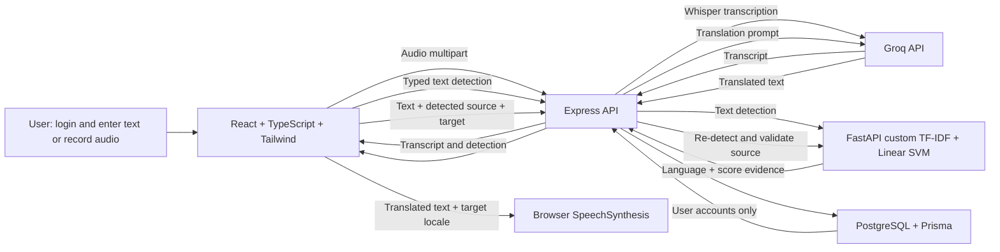

# Architecture

Vaani supports Hindi, English, Tamil, and Odia. The existing custom language model remains the source of source-language decisions. Groq Whisper receives audio without a forced language parameter, then the custom model identifies the returned transcript. Groq chat completions translate; the browser's Web Speech API plays translated output when a matching voice is installed. Users can attempt voice input in any supported language, but Odia transcription has not been independently verified. Odia translated playback depends on an installed `or-IN` speech voice.

## Request flow

1. Express manages signup/login with bcrypt password hashes and HttpOnly session cookies. Prisma/PostgreSQL store user accounts. No translation content or audio is stored.
2. The browser captures WebM/Opus or Ogg/Opus with `getUserMedia` and `MediaRecorder`. It sends one bounded multipart upload to `POST /api/transcribe`; stream tracks are stopped after recording and audio upload begins.
3. Express sends audio bytes to Groq Whisper through the server-side SDK without a language hint. No API key reaches Vite. Whisper's actual transcript is displayed in the editable text area, then checked by the custom model.
4. Typed and transcribed text is sent to `POST /api/detect`. Express proxies it to the unchanged FastAPI model and reports the model's language, confidence kind, and script evidence. The SVM's normalized decision score is presented as a score, not a calibrated probability.
5. `POST /api/translate` includes only text and the chosen target. Express calls FastAPI again, rejects unknown/ambiguous predictions and a same-language target, then sends the model-detected source and selected target to Groq. The LLM is not used to classify language.
6. The browser keeps the result only in the current page state. The prominent playback control reads `translatedText` with an installed voice matching the selected target locale. Pause, resume, stop, and missing voice states use `speechSynthesis`; the backend never returns fabricated or generated audio.

## Security and privacy

- Groq credentials are read only by Express from environment variables.
- Production sessions use Secure, HttpOnly cookies and configured CORS origins.
- Express enforces request and recording size limits, rate limits authentication, and checks model/database readiness at `/health`.
- Raw audio exists in process memory only while it is sent upstream. Transcripts and translation results remain in the current client workspace and are not persisted to PostgreSQL.
- Provider processing is third-party processing. Configure account privacy, quotas and spending limits in Groq before deployment.
